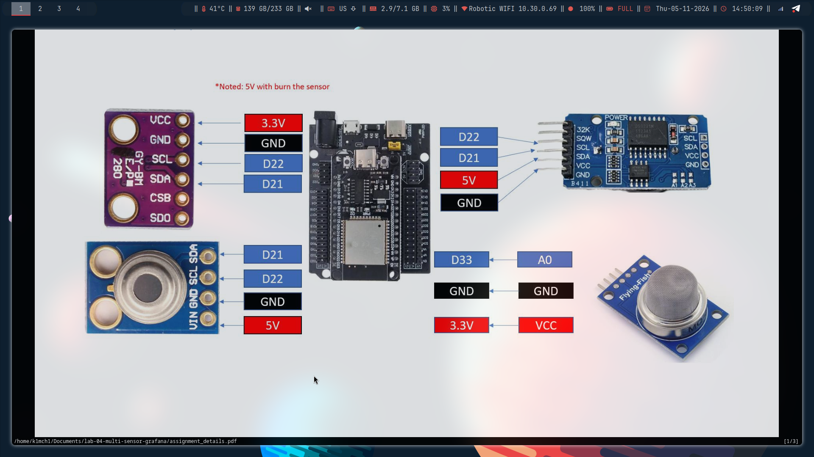
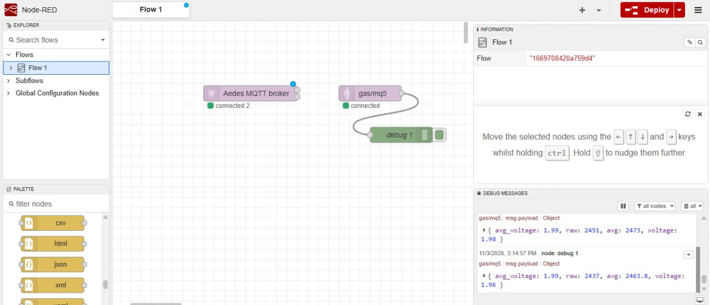
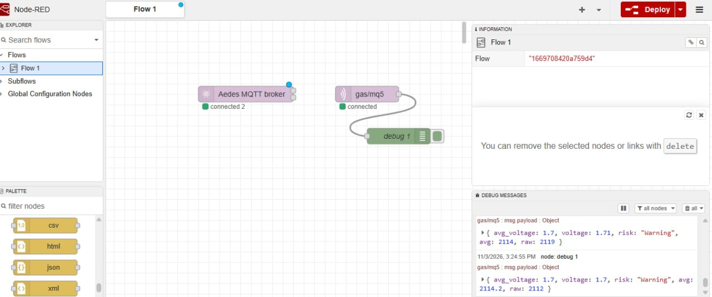
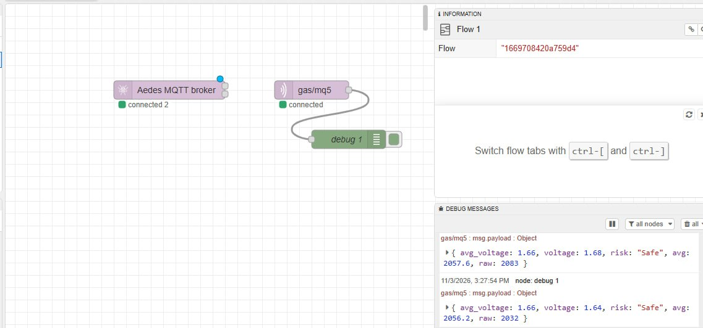
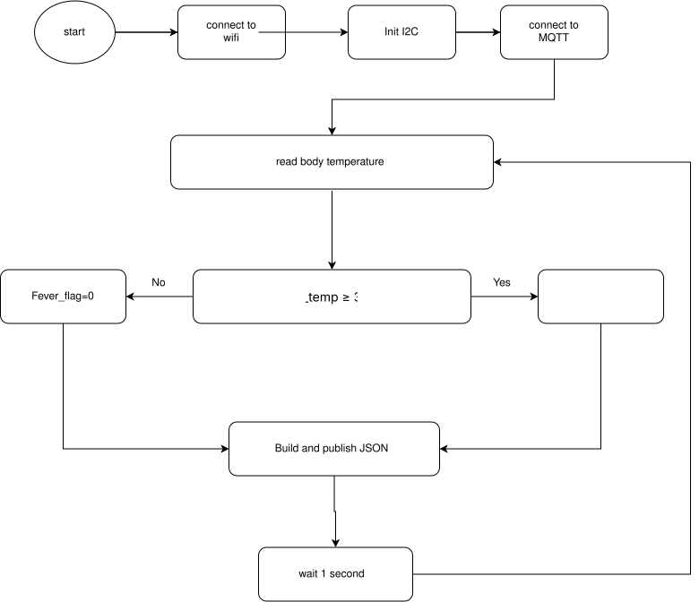
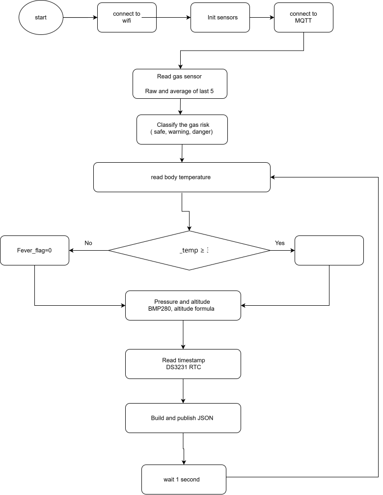
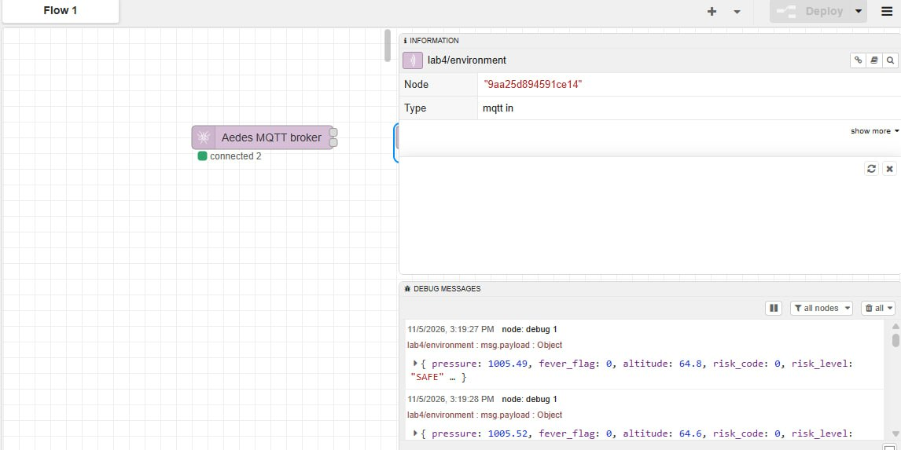
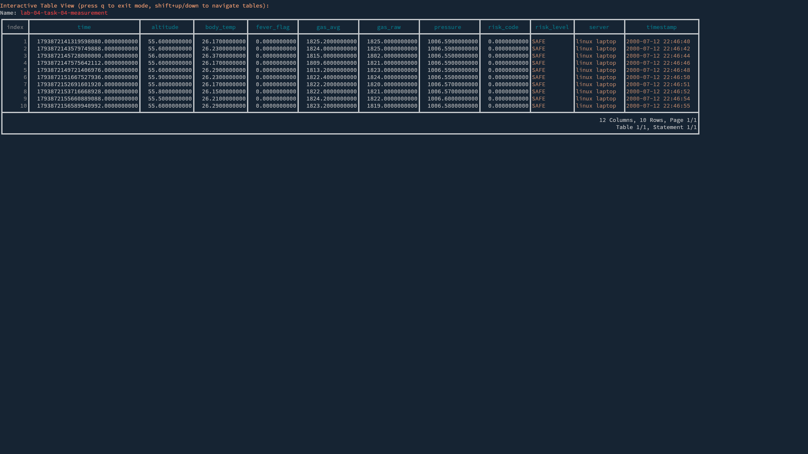
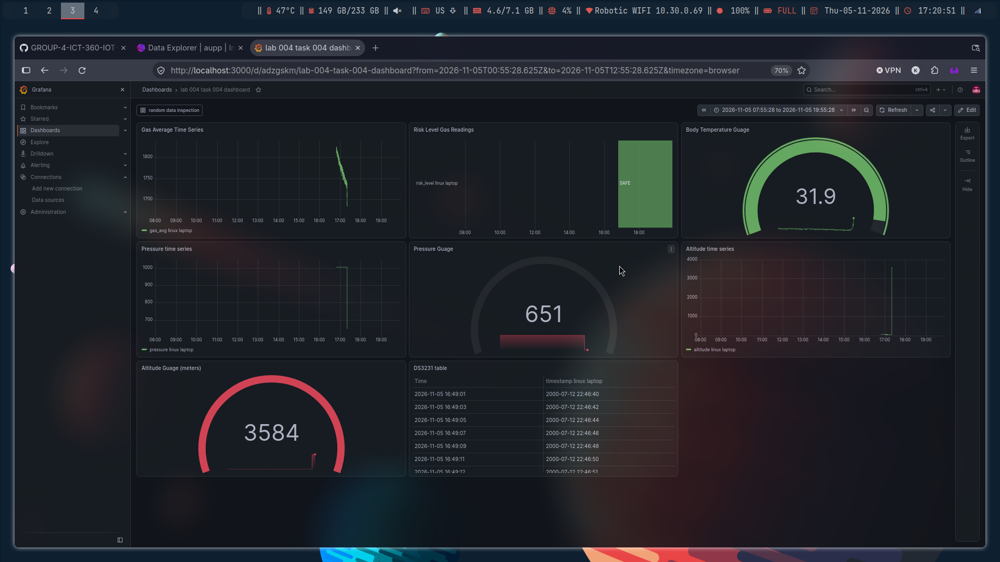

# Wiring

Wiring diagram (from the assignment):



Real wiring on the actual board :


# General Idea

We read the sensor data, processes it and then send the data from the ESP32 to an MQTT broker.

MQTT is a protocol that works over TCP, and we publish it to the MQTT broker, and then we can subscribe to the MQTT broker to receive the data.

We can then take that data and save it to a database, and then view it in Grafana.

# Task 1

Task 1 essentially just reads from the gas sensor and then send it to the MQTT broker.

The code for task 1 is located [here](./task_001_gas_filtering/main.py)

The flowchart for task 1 is as follows:


Example of it running:



# Task 2

Task 2 just updates task 1 so that we also send warning levels.

The flowchart for task 2 is as follows:


The code for task 2 is located [here](./task_001_gas_filtering/main.py)

Example of it running:





# Task 3

Task 3 reads the body temperature and then send it to the MQTT broker.

The flowchart for task 3 is as follows:



The code for task 3 is located [here](./task_003_fever_detection_logic/main.py)

# Task 4

Task 4 is divided into 2 parts:

- the MQTT publisher (ESP32)
- the MQTT subscriber (Seperate computer with a database server)

## MQTT publisher

The MQTT publisher just reads all sensor data, compute all values, and then send it to the MQTT broker

The code for the MQTT publisher is located [here](./task_004_pressure_altitude_monitoring/mqtt_publisher.py)

We can upload the code by doing:

```
mpremote ./task_004_pressure_altitude_monitoring/mqtt_publisher/main.py :main.py
```

And then the code should run everytime we reboot the device

The flowchart for the MQTT publisher (on the ESP32):




Simple MQTT output from node red:



## MQTT subscriber

So we can use node red to subscribe to the MQTT broker and then save it to an `influxdb`, or we can also use a python script to do the same thing.

For testing, we can use something like `mosquitto_sub` to listen to it.

```
$ mosquitto_sub -t lab4/environment -h "10.30.0.99" -p 1883
{"pressure": 650.65, "fever_flag": 0, "altitude": 3583.6, "risk_code": 0, "risk_level": "SAFE", "body_temp": 29.51, "gas_raw": 1905, "timestamp": "2000-07-12 21:56:44", "gas_avg": 1906.4}
{"pressure": 650.65, "fever_flag": 0, "altitude": 3583.6, "risk_code": 0, "risk_level": "SAFE", "body_temp": 29.51, "gas_raw": 1904, "timestamp": "2000-07-12 21:56:45", "gas_avg": 1906.4}
{"pressure": 650.65, "fever_flag": 0, "altitude": 3583.6, "risk_code": 0, "risk_level": "SAFE", "body_temp": 29.45, "gas_raw": 1904, "timestamp": "2000-07-12 21:56:46", "gas_avg": 1906.4}
```

### Starting `influxdb`

First of all, we will start the `influxdb` service

```
sudo systemctl start influxdb.service
```

Now we can see it running by doing `sudo systemctl status influxdb`

Now we can configure the database by going to `http://localhost:8086`

To send data to the database using python, first, we create a virtual environment (optional) and then just install:

```
pip install influxdb-client
```

Or if using `uv`:

```
uv add influxdb-client
```

We can send random numbers like this:

```python
import random
import env

from influxdb_client import InfluxDBClient, Point
from influxdb_client.client.write_api import SYNCHRONOUS

URL = "http://localhost:8086"
ORG = "aupp"
BUCKET = "random-numbers"
TOKEN = env.TOKEN
WRITE_AMOUNT = 100

RANDOM_RANGE = (0, 100)

if __name__ == "__main__":
    with InfluxDBClient(url=URL, token=TOKEN, org=ORG) as client:
        with client.write_api(write_options=SYNCHRONOUS) as write_api:
            for _ in range(WRITE_AMOUNT):
                number = random.randint(*RANDOM_RANGE)

                point = (
                    Point("random_numbers")
                    .field("value", float(number))
                )

                write_api.write(
                    bucket=BUCKET,
                    record=point,
                )

                print(f"Wrote: {number}")
```

More practically, we create a new bucket called `lab-04-task-04`

### Subscribing to MQTT client using python

The most common method it to use this library:

```
uv add paho-mqtt
```

Now we can run the middle man, the code is located [here](./task_004_pressure_altitude_monitoring/mqtt_subscriber/src/main.py)

Just change directory on there and just run (if have UV):

```
uv run ./src/main.py
```

We can view the data in influxdb



### Grafana

Now we can query from Grafana

First we must start the Grafana service:

```
systemctl status grafana
```

Now we can visit `http://localhost:3000`

The sampled query for the flux language looks like this:

```
from(bucket: "lab-04-task-04")
  |> range(start: v.timeRangeStart, stop:v.timeRangeStop)
  |> filter(fn: (r) =>
    r._measurement == "lab-04-task-04-measurement" and
    r._field == "risk_level"
  )
```

Picture of Grafana dashboard:



Video showcase is linked [here](https://youtu.be/UGs35kIkLPs?si=jE977pMJXrcGKdzb).
